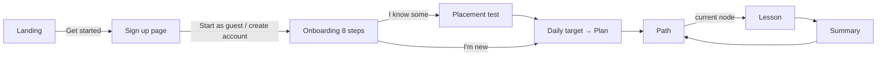

# User workflows

Each workflow lists the happy path and the edge cases the implementation handles. Workflows marked ✔ are exercised by
`e2e/smoke.mjs`.

## W1 First visit → first lesson ✔

Edge cases: no Supabase configured → guest path only, explained on the page. Returning guest → "Continue learning".
Placement score ≥ 80% opens Unit 3, ≥ 50% Unit 2, otherwise Unit 1; starter courses skip placement.

## W2 Lesson loop ✔
1. Exercise appears; target-language prompts auto-play if sound is on.
2. Learner answers → **Check** (or Enter). Matching pairs submit themselves.
3. Feedback sheet: verdict, correct answer, typo/accent note, optional **Explain**.
4. **Continue**. A missed exercise is appended to the queue and returns tagged "Let's try again".
5. After the last item → summary: XP, accuracy, gems, streak, quests, achievements.

Edge cases: "Can't speak/listen now" skips that exercise type for the rest of the session and removes it from the score.
Quitting asks for confirmation and saves nothing. Microphone blocked or unsupported → reason shown, skip offered.

## W3 Returning learner
Open app → path scrolls from the top with one pulsing node → lesson. If words are due, up to two review questions are
woven into the new lesson, and Practice shows a badge with the count.

## W4 Practice ✔
Practice hub → Smart review (due words first) / Fix my mistakes / Listening / Speaking. With no completed lessons the
session screen explains why and links back to the path.

## W5 Story ✔
Unit complete → story node opens. Lines reveal one at a time with audio; tap a line for its translation; comprehension
questions block progress until answered correctly (wrong tries cost only the perfect bonus).

## W6 Tutor ✔
Tutor → scenario → Kiko opens the scene → learner replies by typing or dictating → reply with translation, correction
and tip → transcript saved under "Conversation history". Without an AI provider, scripted scenes run and AI-only
scenarios are disabled with an explanation.

## W7 Jump ahead
Locked unit → "Know this already? Jump here" → test over all earlier units → ≥ 80% unlocks, otherwise an encouraging
"not yet" summary. No penalty either way.

## W8 Account (needs Supabase; not exercised end to end)
Sign up → profile row created by trigger → device progress copied into the empty account → later sessions load from
and diff-write to Supabase. Log out returns the app to guest state on that device.

## W9 Motivation
Any session extends the streak once per local day; a missed day consumes a streak freeze if one is equipped. Quests
auto-complete and pay gems; 50 gems buys a freeze (max 2) on `/quests`.
