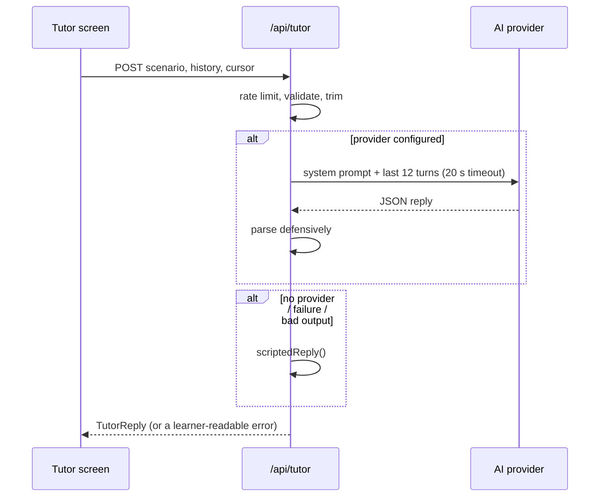

# AI architecture

## Where AI is and is not used
| Task | Approach | LLM? |
|---|---|---|
| Grading exercises | Deterministic comparison | No |
| Explaining an answer | Glossary of the words involved + linked guidebook tip | No (AI explanation planned) |
| Review scheduling | Fixed formula | No |
| Scripted role-play | Keyword check against authored steps | No |
| Open-ended conversation and correction | Chat model via provider abstraction | Yes, optional |
| Course content | Human-authored, human-reviewed | No (AI-assisted drafting allowed only with review — see `CONTENT-AUTHORING.md`) |

## Request flow

## Provider abstraction (`src/lib/tutor/providers.ts`)
`TutorProvider = { name, complete(system, turns) → text }`. Implemented: Anthropic Messages API and any
OpenAI-compatible chat-completions endpoint. Selection by `AI_PROVIDER` or by which keys exist. Keys are read only in
the server route; nothing AI-related is exposed with a `NEXT_PUBLIC_` prefix. Adding a provider is one function.

## Tutor prompt (summary)
Role-play the scenario's character; speak the target language in at most two short sentences at the learner's level;
end with a question; if the learner's message had a mistake give the corrected sentence and one short reason in their
language; never write the learner's next line; stay suitable for all ages and steer off-topic requests back to the
scene; answer only as JSON `{reply, translation, correction, tip, vocab}`.

## Conversation memory
The client sends the transcript; the server keeps none. The last 12 turns go to the model. Transcripts are stored in
the learner model (20 most recent conversations) and synced to `tutor_conversations` for signed-in learners.

## Cost and abuse controls
- 400 output tokens per reply; default model is a small, inexpensive one (`AI_TUTOR_MODEL` overrides).
- 500-character messages, 16-turn history cap.
- 40 requests per 10 minutes per client IP (in-memory, per server instance).
- Scripted scenes and all non-tutor features cost nothing.

Rough cost shape: about 600–900 input and ≤ 400 output tokens per turn — multiply by your provider's current prices;
no figure is quoted here because prices change.

## Status and limits
- The provider path is implemented and unit-tested for parsing, but **was not run against a live provider** in this
  build (no key available).
- No streaming, no speech-to-speech loop, no long-term learner memory across conversations.
- Input moderation relies on the provider's safeguards and the prompt; a dedicated moderation step is recommended before
  opening accounts to minors.
- The rate limiter should move to a shared store (e.g. Postgres or a KV) for multi-instance deployments.
