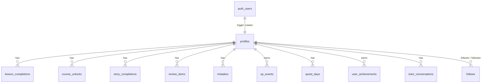

# Database schema

Implemented in two migrations under `supabase/migrations/`: `…000000_learner_core.sql` (tables) and
`…010000_server_authority.sql` (server-only writes, roles, privacy, admin, content suggestions). Both are **applied to
the live Supabase project** (14 tables, row-level security on all of them, 19 policies) and verified twice: by
`supabase/tests/run-local.sh` on plain Postgres 16 and by `e2e/cloud.mts` against the live project.

> The write rules below were tightened by the second migration. See [SERVER-AUTHORITY.md](SERVER-AUTHORITY.md).

## Implemented tables

| Table | Primary key | Purpose | Notable constraints |
|---|---|---|---|
| `profiles` | `id` → `auth.users` | Identity, settings, XP, gems, streak | `username` unique, `^[a-z0-9_]{3,20}$`; `daily_goal_xp ∈ {10,20,30,50}`; `streak_freezes` 0–2; non-negative counters |
| `lesson_completions` | `(user_id, course_id, lesson_id)` | Path progress | `best_accuracy` 0–1 |
| `course_unlocks` | `(user_id, course_id)` | Placement / test-out result | `unit_index ≥ 0` |
| `story_completions` | `(user_id, story_id)` | Stories read | |
| `review_items` | `(user_id, word_key)` | Spaced-repetition schedule per word | `ease` 1.3–2.8; index `(user_id, due_at)` |
| `mistakes` | `(user_id, course_id, sentence_id)` | Sentences to retry | |
| `xp_events` | `(user_id, id)` | Append-only XP ledger; source of weekly leagues | `amount` 1–50; `source` enum check; trigger blocks changing amount/source/time; index `(created_at, user_id)` |
| `quest_days` | `(user_id, day)` | Daily quest progress (JSON items) | |
| `user_achievements` | `(user_id, achievement_id)` | Badges | |
| `tutor_conversations` | `(user_id, id)` | Transcripts | JSON array < 64 KB |
| `follows` | `(follower_id, followee_id)` | Social graph | no self-follow; index on `followee_id` |

All child tables cascade on profile deletion; profiles cascade on `auth.users` deletion (tested).

## Tables added by the second migration

| Table | Primary key | Purpose |
|---|---|---|
| `applied_operations` | `(user_id, operation_id)` | Idempotency ledger and activity log: one row per applied server operation |
| `friend_quest_claims` | `(user_id, friend_id, week)` | One friends-quest reward per friend per week |
| `content_suggestions` | `id` | Corrections proposed by learners; decided by editors/admins |
| `private.app_secrets` | `name` | Signing secret. The `private` schema is not exposed through the API |

`profiles` gained `ui_lang`, `is_public`, `role` (`learner`/`editor`/`admin`), `version` (optimistic lock) and `imported`.

## Row-level security and privileges

| Table | Learner can | Notes |
|---|---|---|
| `profiles` | read own row; update only `display_name, username, native_lang, course_id, goal, level, daily_goal_xp, onboarded, settings, ui_lang, is_public` | Column-level grant. XP, gems, streak, stats, role and version are not writable by clients |
| progress and reward tables (`lesson_completions`, `course_unlocks`, `story_completions`, `review_items`, `mistakes`, `quest_days`, `user_achievements`, `xp_events`, `tutor_conversations`, `applied_operations`, `friend_quest_claims`) | read own rows | Insert/update/delete revoked. Written only by `apply_progress()` |
| `follows` | read if follower or followee; insert/delete as follower | |
| `content_suggestions` | insert own (status `open`), read own | Editors/admins read all and update status |

`anon` can read nothing and call nothing.

## Functions (all `SECURITY DEFINER`, `search_path = ''`, execute granted to `authenticated` only)

| Function | Purpose | Guard |
|---|---|---|
| `apply_progress(payload, signature)` | Applies a signed progress delta atomically | HMAC, owner, freshness, version, idempotency, throttle |
| `weekly_leaderboard(max_rows)` | XP since Monday 00:00 UTC | Exposes id, display name (or “Private learner”), weekly XP |
| `find_profiles(q)` / `suggested_learners()` / `my_friends()` | Discovery and friends | Public profiles only; never email |
| `friend_quests()` | Combined weekly XP with each mutual follow, target 200 | Caller's own pairs only |
| `delete_my_account()` | Erases the caller's account and all rows (cascade) | `auth.uid()` |
| `is_staff(min_role)` | Role check used by policies | — |
| `admin_overview()` / `admin_users(q, n)` / `admin_set_role(id, role)` | Analytics and user management | `role = 'admin'`; an admin cannot change their own role |
| `handle_new_user()` | Trigger: creates the profile on sign-up | Not callable |

The Supabase security advisor reports only that these definer functions are callable by signed-in users, which is
intended: each one checks the caller.

## Data retention
Learners can delete their account from Settings (`delete_my_account`), which cascades to every table. Tutor
transcripts are capped at the 20 most recent per learner in the app and 64 KB each in the database. No speech
recordings are stored: recordings stay in the browser.

## Planned tables (designed, not migrated)

Content moves from Git to the database when the admin editors are built:

| Table | Key columns |
|---|---|
| `languages` | `code` pk, `name`, `tts_locale`, `direction` |
| `courses` | `id` pk, `target_lang` → languages, `native_lang` → languages, `status`, `license` |
| `sections` / `units` / `lessons` | hierarchical fks, `position`, `cefr`, `objective`; unique `(parent_id, position)` |
| `skills` | `unit_id`, `kind` (vocabulary/grammar/listening/speaking) |
| `vocabulary` | `lesson_id`, `target_text`, `native_text`, `audio_asset_id` |
| `sentences` | `lesson_id`, `target_text`, `native_text`, `alternatives text[]` |
| `exercises` / `exercise_options` | for hand-authored items beyond generated ones: `type`, `difficulty`, `prompt`, `answer jsonb`, `explanation` |
| `stories` / `story_lines` / `story_questions` | |
| `audio_assets` | storage path, voice, checksum, licence |
| `content_versions` | entity ref, `version`, `status` (draft/in_review/published), author, reviewer, diff |
| `lesson_sessions` / `answers` | per-attempt log for analytics |
| `speaking_recordings` | opt-in only; storage path, score, retention date |
| `league_cohorts` / `league_memberships` | weekly cohorts of 30 with tier |
| `friend_challenges` | pair, goal, period, progress |

Content tables will be world-readable for `published` rows and writable only by an `editor` role claim.
