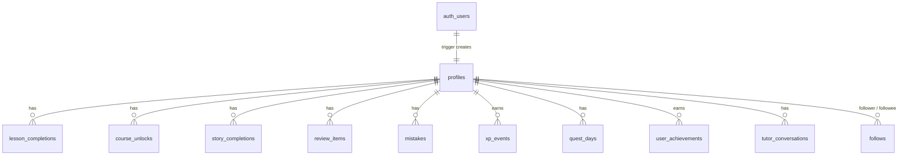

# Database schema

Implemented in `supabase/migrations/20261114000000_learner_core.sql`. Verified by `supabase/tests/run-local.sh` on
Postgres 16 with a stub `auth` schema (all assertions pass). **Not yet applied to a live Supabase project.**

## Implemented tables

| Table | Primary key | Purpose | Notable constraints |
|---|---|---|---|
| `profiles` | `id` → `auth.users` | Identity, settings, XP, gems, streak | `username` unique, `^[a-z0-9_]{3,20}$`; `daily_goal_xp ∈ {10,20,30,50}`; `streak_freezes` 0–2; non-negative counters |
| `lesson_completions` | `(user_id, course_id, lesson_id)` | Path progress | `best_accuracy` 0–1 |
| `course_unlocks` | `(user_id, course_id)` | Placement / test-out result | `unit_index ≥ 0` |
| `story_completions` | `(user_id, story_id)` | Stories read | |
| `review_items` | `(user_id, word_key)` | Spaced-repetition schedule per word | `ease` 1.3–2.8; index `(user_id, due_at)` |
| `mistakes` | `(user_id, course_id, sentence_id)` | Sentences to retry | |
| `xp_events` | `(user_id, id)` | Append-only XP ledger; source of weekly leagues | `amount` 1–50; `source` enum check; trigger blocks changing amount/source/time; index `(created_at, user_id)` |
| `quest_days` | `(user_id, day)` | Daily quest progress (JSON items) | |
| `user_achievements` | `(user_id, achievement_id)` | Badges | |
| `tutor_conversations` | `(user_id, id)` | Transcripts | JSON array < 64 KB |
| `follows` | `(follower_id, followee_id)` | Social graph | no self-follow; index on `followee_id` |

All child tables cascade on profile deletion; profiles cascade on `auth.users` deletion (tested).

## Row-level security

| Table | Policy | Rule |
|---|---|---|
| `profiles` | select, update own | `auth.uid() = id`. No client insert/delete — rows are created by the `handle_new_user` trigger |
| progress tables (8) | `own rows` for all commands | `auth.uid() = user_id` in both `using` and `with check` |
| `xp_events` | select / insert / update own | plus immutability trigger; no delete policy |
| `follows` | select if follower or followee; insert/delete as follower | |

`anon` has no policy on any table. Tested: reading or writing another learner's rows fails, anonymous reads return
nothing, XP over the cap is rejected.

## Functions (SECURITY DEFINER, `search_path = ''`, execute granted to `authenticated` only)

| Function | Returns | Exposes |
|---|---|---|
| `weekly_leaderboard(max_rows)` | top learners by XP since Monday 00:00 UTC | id, display name, weekly XP |
| `find_profiles(q)` | up to 10 username prefix matches, excluding self | username, display name, XP, streak, following flag |
| `my_friends()` | followees | same projection |
| `handle_new_user()` | trigger | creates profile; falls back to `learner_<id suffix>` for taken/invalid usernames |

## Planned tables (designed, not migrated)

Content moves from Git to the database when the admin editors are built:

| Table | Key columns |
|---|---|
| `languages` | `code` pk, `name`, `tts_locale`, `direction` |
| `courses` | `id` pk, `target_lang` → languages, `native_lang` → languages, `status`, `license` |
| `sections` / `units` / `lessons` | hierarchical fks, `position`, `cefr`, `objective`; unique `(parent_id, position)` |
| `skills` | `unit_id`, `kind` (vocabulary/grammar/listening/speaking) |
| `vocabulary` | `lesson_id`, `target_text`, `native_text`, `audio_asset_id` |
| `sentences` | `lesson_id`, `target_text`, `native_text`, `alternatives text[]` |
| `exercises` / `exercise_options` | for hand-authored items beyond generated ones: `type`, `difficulty`, `prompt`, `answer jsonb`, `explanation` |
| `stories` / `story_lines` / `story_questions` | |
| `audio_assets` | storage path, voice, checksum, licence |
| `content_versions` | entity ref, `version`, `status` (draft/in_review/published), author, reviewer, diff |
| `lesson_sessions` / `answers` | per-attempt log for analytics and server-side scoring |
| `speaking_recordings` | opt-in only; storage path, score, retention date |
| `league_cohorts` / `league_memberships` | weekly cohorts of 30 with tier |
| `friend_challenges` | pair, goal, period, progress |

Content tables will be world-readable for `published` rows and writable only by an `editor` role claim.
