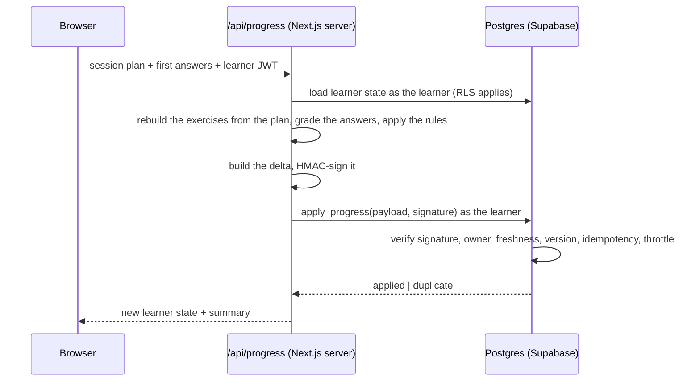

# Server authority for progress and rewards

Since release 0.2 a signed-in learner's browser cannot change XP, gems, streaks, lesson completions, quests,
achievements, review schedules or leaderboard scores. Guest mode is unchanged: it never touches the server.

## Flow

1. **Plan** (`src/lib/engine/plan.ts`): a session is described by `{type, courseId, lessonId | mode | unit, seed, …}`.
   Exercise generation is deterministic, so the server rebuilds exactly what the learner saw.
2. **Grading** (`src/lib/engine/grade.ts`): the server grades the learner's *first* attempt at each exercise with the
   same `evaluate` function the UI uses. Every exercise must be answered or legitimately skipped (speaking and
   listening only), otherwise the request is rejected.
3. **Rules** (`src/lib/state/actions.ts`): XP formula, streak (in the learner's time zone), quests, achievements and
   spaced repetition run on the server. For lessons and stories the server also checks the unlock order.
4. **Signature** (`src/lib/server/progress.ts`): the changed rows are serialised and signed with HMAC-SHA-256 using
   `PROGRESS_SIGNING_SECRET`.
5. **Database** (`apply_progress` in `supabase/migrations/20261114010000_server_authority.sql`) applies the delta in
   one transaction after checking:

| Check | Prevents |
|---|---|
| HMAC matches the secret in `private.app_secrets` | Forged or tampered payloads |
| `user_id` in the payload equals `auth.uid()` | Applying someone else's payload |
| `issued_at` within 5 minutes | Old captured payloads |
| `operation_id` not in `applied_operations` | Replays and double rewards (returns `duplicate`) |
| `base_version` equals `profiles.version` | Stale or concurrent writes; replay against newer state |
| No session applied in the last 10 seconds | XP farming by script |
| Table constraints (XP per event ≤ 50, counters ≥ 0, freezes ≤ 2) | Out-of-range values even from a buggy server |

Learners keep `select` on their own rows and `update` on a column allow-list of `profiles` (name, course, goal,
settings, interface language, privacy). All other writes are revoked.

## Other operations through the same door
`freeze` (spend 50 gems), `conversation` (store a tutor transcript, counts toward an achievement), `friend_claim`
(20 gems when a friends quest reaches its target; verified against `friend_quests()`), `import` (see below).

## Guest-to-account import
A guest's device progress is untrusted. On first log-in the server rebuilds it (`sanitizeGuest`): only lessons that
exist and are reachable in order are kept; XP, gems and streak are capped at what those sessions could have paid; the
import is allowed once, only into an account with no progress, and the device copy is then cleared.

## What is still trusted from the client
- **Speaking transcripts and matching-pair mistake counts** are reported by the browser. They affect only whether one
  exercise counts as correct (at most the 5 XP perfect bonus).
- **Session duration** is informational; the 10-second server-side throttle is what limits farming.
- Placement and jump-ahead tests are graded on the server, but nothing of value is gated by them (all content is free).

## Operating notes
- The secret must be identical in the app environment and in `private.app_secrets` (`progress_hmac`). Rotate by
  updating both; in-flight requests fail safely with `bad_signature`.
- Verified against the live project by `e2e/cloud.mts` (forged writes, replay, throttle, locked lessons, incomplete
  answers, import abuse) and against plain Postgres by `supabase/tests/rls_test.sql`.
