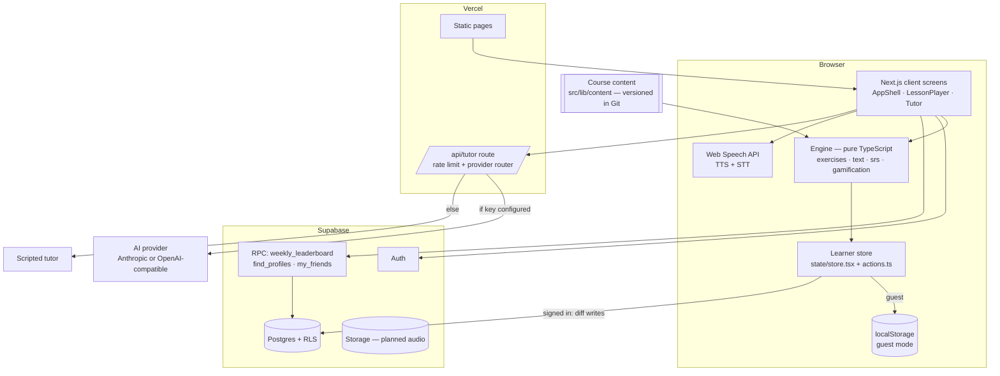

# System architecture

## Overview

## Modules and boundaries

| Module | Location | Depends on | Notes |
|---|---|---|---|
| Content | `src/lib/content` | — | Typed data + linter. No UI, no I/O |
| Exercise engine | `src/lib/engine/{exercises,text}.ts` | Content | Generation and grading; deterministic given a seed |
| Adaptive engine | `src/lib/engine/srs.ts` | — | Spaced repetition |
| Gamification | `src/lib/engine/gamification.ts` | state types | XP, streak, quests, achievements, leagues |
| Learner model | `src/lib/state/{types,actions}.ts` | engines | Pure `(state, event, now) → state` |
| Persistence | `src/lib/state/{persistence,store}.tsx` | Supabase client | Local and cloud adapters behind one store |
| Tutor | `src/lib/tutor`, `src/app/api/tutor` | — | Provider abstraction + scripted fallback |
| Speech | `src/lib/audio.ts` | Browser APIs | TTS, STT, synthesised effects |
| UI | `src/components`, `src/app` | everything above | No business rules in components |
| Admin | `src/app/admin/content` | Content | Read-only review |

Rule: dependencies point downward in this table. Engines never import React, Supabase or `window`.

## Key decisions

| Decision | Why | Trade-off |
|---|---|---|
| Content as code in Git (MVP) | Reviewable diffs, type checking, zero query cost, works offline | Authors need Git; DB-backed editor is on the roadmap |
| Engines run in the browser | Instant feedback, works in guest mode, no server cost | XP is client-computed and can be forged — see Risks |
| One store, two adapters | Guest mode and accounts share all logic | Guest data lives in one browser |
| Diff-based cloud writes | Small idempotent upserts; no custom sync protocol | Last write wins across devices |
| Scripted tutor fallback | Product works with no AI budget or during outages | Limited scenarios |
| Browser speech | Free, private-ish, no infrastructure | Quality and availability vary by browser |

## Planned components (not built)
Analytics pipeline, admin dashboard and editors, audio asset storage, server-side session authority, scheduled league
jobs, push/email reminders.

## Risks
1. **Forgeable XP** — mitigated by DB caps (≤ 50 XP per event, append-only ledger); fix is server-side awarding (roadmap 0.3).
2. **Untested cloud path** — the Supabase adapter compiles and the schema is verified on local Postgres, but no live project was available; expect integration fixes at go-live.
3. **In-memory rate limit** — per serverless instance; move to a shared store before heavy AI use.
