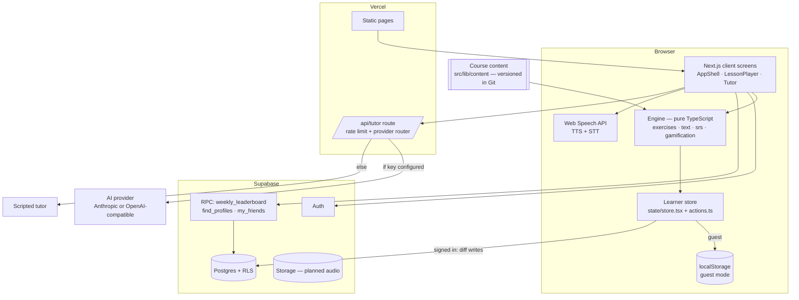

# System architecture

## Overview

## Modules and boundaries

| Module | Location | Depends on | Notes |
|---|---|---|---|
| Content | `src/lib/content` | — | Typed data + linter. No UI, no I/O |
| Exercise engine | `src/lib/engine/{exercises,text}.ts` | Content | Generation and grading; deterministic given a seed |
| Adaptive engine | `src/lib/engine/srs.ts` | — | Spaced repetition |
| Gamification | `src/lib/engine/gamification.ts` | state types | XP, streak, quests, achievements, leagues |
| Learner model | `src/lib/state/{types,actions}.ts` | engines | Pure `(state, event, now) → state` |
| Persistence | `src/lib/state/{persistence,store}.tsx` | Supabase client | Local and cloud adapters behind one store |
| Tutor | `src/lib/tutor`, `src/app/api/tutor` | — | Provider abstraction + scripted fallback |
| Speech | `src/lib/audio.ts` | Browser APIs | TTS, STT, synthesised effects |
| UI | `src/components`, `src/app` | everything above | No business rules in components |
| Admin | `src/app/admin/content` | Content | Read-only review |

Rule: dependencies point downward in this table. Engines never import React, Supabase or `window`.

## Key decisions

| Decision | Why | Trade-off |
|---|---|---|
| Content as code in Git (MVP) | Reviewable diffs, type checking, zero query cost, works offline | Authors need Git; DB-backed editor is on the roadmap |
| Engines are pure TypeScript shared by browser and server | Instant feedback in the UI; the same code re-grades on the server for signed-in learners | Two runtimes to keep deterministic (covered by tests) |
| One store, two adapters | Guest mode and accounts share all logic | Guest data lives in one browser |
| Signed, versioned deltas | One atomic, idempotent database call per operation | A stale device must reload and retry |
| Scripted tutor fallback | Product works with no AI budget or during outages | Limited scenarios |
| Browser speech | Free, private-ish, no infrastructure | Quality and availability vary by browser |

## Planned components (not built)
Course/lesson/exercise editors backed by content tables, audio asset storage, scheduled league jobs with
promotion, push/email reminders, error reporting.

## Risks
1. **Residual client trust** — speaking transcripts and matching mistake counts come from the browser (bounded effect;
   see [SERVER-AUTHORITY.md](SERVER-AUTHORITY.md)).
2. **Email delivery** — sign-up confirmation and password recovery use Supabase's built-in mailer, which is
   rate-limited to a few messages per hour. Configure custom SMTP before real traffic.
3. **In-memory rate limit and cache on `/api/tutor`** — per serverless instance; move to a shared store before heavy AI use.
4. **AI and server TTS paths are untested against live providers** — no keys were available.
